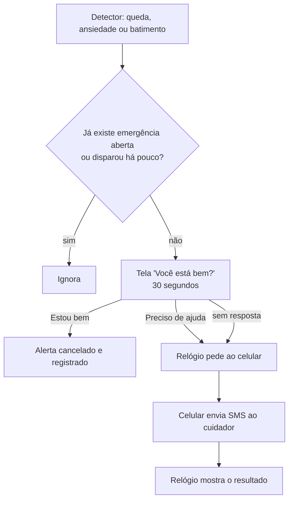
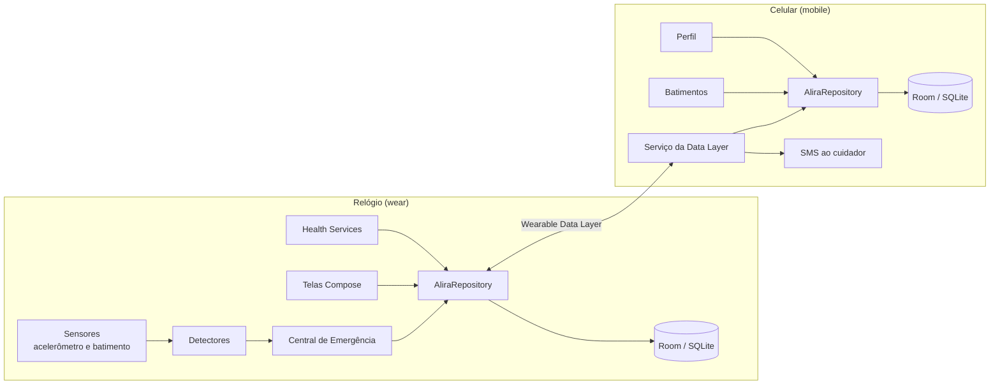

# Alira

TCC do curso de **Desenvolvimento de Sistemas** da **ETEC de Itaquera**.

Muita gente com deficiência mora sozinha ou passa boa parte do dia sem ninguém por perto. Se essa pessoa cai ou passa mal em casa, pode demorar horas até alguém perceber. O Alira nasceu para resolver isso, e é formado por dois apps que trabalham juntos:

- **Relógio (Wear OS)**: fica no pulso o tempo todo. Mede os batimentos e a atividade do dia e percebe quando algo parece errado, como uma queda, uma possível crise de ansiedade ou o coração fora do normal. Antes de chamar alguém, ele pergunta para a própria pessoa: "Você está bem?".
- **Celular (Android)**: é onde ficam o perfil da pessoa e os dados do cuidador. Ele mostra os gráficos com o que o relógio mediu, tem recursos de acessibilidade próprios e é quem manda o SMS para o cuidador na hora da emergência.

---

## Sumário

- [Funcionalidades](#funcionalidades)
- [Como funciona](#como-funciona)
- [Acessibilidade](#acessibilidade)
- [Arquitetura](#arquitetura)
- [Tecnologias](#tecnologias)
- [Estrutura do projeto](#estrutura-do-projeto)
- [Banco de dados](#banco-de-dados)
- [Comunicação relógio e celular](#comunicação-relógio-e-celular)
- [Permissões](#permissões)
- [Como rodar](#como-rodar)
- [Como testar](#como-testar)
- [Limitações e próximos passos](#limitações-e-próximos-passos)
- [Autores](#autores)

---

## Funcionalidades

Um resumo do que cada tela faz.

### Relógio (módulo `wear`)

| Tela | O que faz |
|---|---|
| **Início** | A primeira tela. Dá um "Olá" com o nome da pessoa e tem cartões grandes, fáceis de tocar, para cada parte do app. |
| **Sinais Vitais** | Quatro páginas que você desliza para o lado: batimento (com um gráfico das últimas medições), passos (um anel que vai enchendo até a meta de 10.000), calorias e distância. |
| **Monitoramento** | Um painel ao vivo, que é o que a gente usa na apresentação. Mostra em que ponto está a detecção de queda, um gráfico da força do movimento, se a pessoa está parada e os batimentos. É aqui também que ficam as chaves "Monitoramento contínuo" e "Modo demonstração". |
| **Relatórios** | Gera um PDF com as últimas 24 horas, manda as leituras novas para o celular e mostra o histórico. |
| **Configurações** | Leva para Acessibilidade, Monitoramento e Cuidador (que mostra os dados preenchidos no celular). Também tem botões que simulam cada tipo de emergência. |
| **Emergência** | A tela "Você está bem?". Metade dela é o botão "ESTOU BEM" e a outra metade é "PRECISO DE AJUDA". A pessoa tem 30 segundos para responder. |

### Celular (módulo `mobile`)

| Tela | O que faz |
|---|---|
| **Início** | Cartões para Relatórios, Batimentos cardíacos, Leitor de tela e Leitor de imagem. |
| **Perfil** | Onde a pessoa coloca os dados dela, marca as deficiências (dá para marcar mais de uma) e preenche o cuidador: nome, telefone, e-mail e parentesco. Quando ela sai da tela, tudo é salvo e vai sozinho para o relógio. |
| **Batimentos** | Um gráfico de barras com a média dos batimentos por ano, mês ou semana, e a lista das últimas leituras que vieram do relógio. |
| **Acessibilidade** | Um leitor de tela próprio, troca de fonte (Quicksand, OpenDyslexic ou Arial) e controles para aumentar o texto e os botões. |
| **Leitor de imagem** | A pessoa tira uma foto (ou escolhe uma da galeria), o app reconhece o texto que tem nela e lê em voz alta. O reconhecimento é feito no próprio celular. |

---

## Como funciona

### Detecção de queda

Uma queda tem um "jeito" bem característico, e é esse jeito que o relógio procura. Ele lê o acelerômetro (o sensor que mede o movimento) umas 50 vezes por segundo e espera acontecerem três coisas, nessa ordem:

1. **Queda livre**: por um instante, o corpo fica quase sem peso e a força medida cai abaixo de 0,6 g.
2. **Impacto**: em até 1 segundo, vem uma pancada forte, acima de 2,5 g. É o corpo batendo no chão.
3. **Imobilidade**: o relógio espera 1,5 s e confere se a pessoa continua parada por mais 2,5 s.

O "g" é a unidade dessa força. Com a pessoa parada, o relógio mede mais ou menos 1 g.

Só quando as três coisas acontecem é que conta como queda. É isso que evita alarme falso: bater a mão na mesa só tem a pancada, andar não tem a queda livre, e quem cai e levanta logo não fica parado.

O **Modo demonstração** deixa o detector mais sensível (o impacto passa a ser 1,8 g), para dar para mostrar a queda caindo num colchão. Ele vem desligado e não é para usar no dia a dia.

No código, esses números ficam todos juntos, o que facilita ajustar depois:

```kotlin
// wear/.../monitoramento/DetectorDeQueda.kt
val NORMAL = LimitesQueda(
    quedaLivreG = 0.6f,
    impactoG = 2.5f,
    janelaQuedaLivreMs = 1_000L,
    esperaAposImpactoMs = 1_500L,
    janelaImobilidadeMs = 2_500L,
    variacaoMaximaParadoG = 0.35f,
)
```

### Outras emergências

Além da queda, o relógio fica de olho no coração:

| Tipo | Quando dispara |
|---|---|
| **Batimento fora do normal** | O coração fica abaixo de 40 ou acima de 160 batimentos por minuto durante 15 segundos seguidos. |
| **Crise de ansiedade** | O batimento passa de 100 e fica 40% acima da média da própria pessoa (dos últimos 7 dias), com ela parada, por 2 minutos. Nesse caso o relógio pergunta duas vezes antes de avisar alguém. |

Importante: a parte da ansiedade não é um diagnóstico médico. É só um motivo para o relógio perguntar se está tudo bem.

### Fluxo de emergência

Não importa o que disparou o alerta, o caminho é sempre o mesmo:



O SMS que chega para o cuidador é mais ou menos assim: *"ALIRA: o relógio de Ana detectou uma possível queda às 14:35. A pessoa não respondeu ao relógio. Tente entrar em contato agora."*

Para o relógio não ficar perguntando toda hora, depois de um alerta automático ele espera 10 minutos antes de disparar outro do mesmo tipo (no modo demonstração, só 15 segundos).

### Monitoramento em segundo plano

O relógio mede de dois jeitos:

- **Passivo (sempre ligado)**: o próprio Wear OS, pelo Health Services, junta batimentos, passos, calorias e distância e vai entregando ao app. Isso gasta pouca bateria.
- **Contínuo (opcional)**: uma queda dura menos de um segundo, então para pegá-la o relógio precisa olhar o acelerômetro sem parar. Quem faz isso é um serviço que roda mesmo com o app fechado e deixa fixa a notificação "ALIRA monitorando", para a pessoa saber que está sendo monitorada. Se o relógio reiniciar, ele volta sozinho. Como gasta mais bateria, é opcional.

---

## Acessibilidade

Esse foi o ponto que a gente mais cuidou, porque o Alira é feito para pessoas com deficiência.

### No relógio

| Recurso | O que faz |
|---|---|
| **Fonte de alto contraste** | Deixa o fundo preto com destaques amarelos e as letras 30% maiores, em todas as telas. |
| **Sinais de vibração** | O relógio vibra a cada toque, e vibra forte nos alertas. |
| **Texto para voz** | O relógio fala o nome do botão tocado e lê os valores em voz alta. |

Essas opções já começam ligadas de acordo com a deficiência marcada no Perfil do celular. Na emergência, o jeito de avisar também muda:

| Perfil | Como é avisado |
|---|---|
| Deficiência auditiva | Sem som. O relógio vibra forte e a faixa da tela pisca uma vez por segundo. Esse ritmo é devagar de propósito, para não fazer mal a quem tem epilepsia fotossensível. |
| Deficiência visual | O relógio lê a pergunta em voz alta e vai avisando quanto tempo falta. |
| Sem deficiência marcada | Alarme com som e vibração. |

### No celular

- Um leitor de tela próprio: o primeiro toque lê o item e o segundo ativa. Se o TalkBack (o leitor do próprio Android) estiver ligado, ele fica quieto para não falar por cima.
- Fontes Quicksand, OpenDyslexic (feita para quem tem dislexia) e Arial.
- Controle do tamanho da letra (de 0,8x a 1,6x) e dos botões.
- O leitor de imagem, que transforma o texto de uma foto em voz.

---

## Arquitetura

Este é o desenho geral de como as partes se ligam:



- **Camadas**: as telas e os serviços nunca mexem direto no banco. Eles sempre passam pelo `AliraRepository`, que funciona como um "balcão de atendimento" e conversa com o banco pelos DAOs do Room. Os métodos do diagrama de classes do TCC (`coletarBiometria`, `gerarAlerta`, `gerarPDF`, `enviarDados`...) estão nele, com os mesmos nomes.
- **Telas que se atualizam sozinhas**: o banco e os serviços avisam quando alguma coisa muda (usando `Flow` e `StateFlow`), e as telas se redesenham na hora, sem precisar recarregar.
- **Emergência**: funciona como uma sequência de passos (perguntando, avisando, resultado...), controlada por uma máquina de estados (`sealed interface EstadoEmergencia`) com coroutines. Cada passo tem um tempo limite, tanto para a resposta da pessoa quanto para a do celular.

---

## Tecnologias

O que a gente usou em cada app:

| | Relógio (`wear`) | Celular (`mobile`) |
|---|---|---|
| Linguagem | Kotlin | Kotlin |
| Interface | Jetpack Compose para Wear OS (Material 3) | Activities + layouts XML |
| Navegação | Navigation3 | Intents e menu lateral (DrawerLayout) |
| Banco | Room (SQLite), versão 2 | Room (SQLite), versão 2 |
| Saúde e sensores | Health Services, SensorManager | |
| Comunicação | Wearable Data Layer (MessageClient) | Wearable Data Layer (MessageClient) |
| Outros | Coroutines, Flow, TextToSpeech, PdfDocument | MPAndroidChart, CameraX, ML Kit (texto), TextToSpeech, SmsManager |
| SDK mínimo | API 30 (Wear OS 3) | API 24 (Android 7) |

Para compilar: Gradle 9.4.1, Android Gradle Plugin 9.2.1, Kotlin 2.2.10 e KSP (usado pelo Room).

---

## Estrutura do projeto

Como as pastas estão organizadas:

```
Alira/
├── wear/                         App do relógio
│   ├── schemas/                  Formato do banco (gerado pelo Room)
│   └── src/main/java/me/slz_br/alira/
│       ├── acessibilidade/       Gerenciador e retorno por vibração e voz
│       ├── data/
│       │   ├── db/               Banco Room: entidades, DAOs, migração
│       │   ├── repository/       AliraRepository e HealthServiceRepository
│       │   └── sync/             Data Layer e monitoramento passivo
│       ├── emergencia/           Central de Emergência, tipos, sinais e notificação
│       ├── monitoramento/        Detectores, serviço contínuo e painel ao vivo
│       └── presentation/         MainActivity, tema, navegação, componentes e telas
├── mobile/                       App do celular
│   └── src/main/java/com/example/telainicial/
│       ├── data/
│       │   ├── db/               Banco Room: usuário, cuidador, leituras
│       │   ├── repository/       AliraRepository (perfil, contatos, leituras)
│       │   └── sync/             Data Layer e envio de SMS
│       ├── util/                 Deficiências e validações
│       └── *.kt                  Telas: Main, Perfil, Batimentos, Acessibilidade, Leitor de imagem
├── gradle/libs.versions.toml     Catálogo de versões
└── settings.gradle.kts           Módulos e repositórios
```

---

## Banco de dados

Os dados ficam salvos só nos aparelhos, num banco SQLite. A gente usa o Room, que facilita trabalhar com ele. As tabelas seguem o diagrama de classes do TCC.

### Relógio

| Tabela | O que guarda |
|---|---|
| `usuario` | A pessoa monitorada. Os dados vêm do Perfil do celular; enquanto não chegam, o relógio usa um usuário provisório. |
| `acessibilidade` | Os 3 recursos de acessibilidade e se cada um está ligado. |
| `monitoramento` | Cada medição: batimento, passos, calorias, distância, data e hora. |
| `alerta` | Cada emergência e como ela terminou: `CANCELADO` (a pessoa disse que está bem), `ENVIADO_AO_CUIDADOR` ou `FALHA_AO_AVISAR`. |
| `relatorio` | Os relatórios gerados e onde o PDF foi salvo. |
| `cuidador` | Nome, telefone, e-mail e parentesco do cuidador. |

Na versão 2 do banco entraram as colunas `calorias`, `passos` e `distancia` na tabela `monitoramento`. A mudança foi feita de um jeito que não apaga nenhum dado antigo.

### Celular

O celular tem `usuario`, `cuidador`, `relatorio` e `monitoramento`, que guarda as leituras que vieram do relógio. Essa última entrou na versão 2, com uma regra que impede a mesma leitura de ser salva duas vezes.

---

## Comunicação relógio e celular

Relógio e celular conversam pela **Wearable Data Layer**, que é o jeito oficial do Google para isso. Para funcionar, os dois apps precisam ter o mesmo `applicationId` (`me.slz_br.alira`), que é tipo o "nome de instalação" do app, e a mesma assinatura.

Cada tipo de mensagem tem um "endereço" próprio:

| Caminho | Direção | O que vai |
|---|---|---|
| `/alira/usuario_cadastrado` | celular → relógio | O perfil da pessoa e os dados do cuidador |
| `/alira/emergencia` | relógio → celular | Uma emergência confirmada, para o celular mandar o SMS |
| `/alira/emergencia_resultado` | celular → relógio | Se o SMS foi enviado e para quem |
| `/alira/alerta` | relógio → celular | O aviso de que um alerta foi gerado |
| `/alira/leituras` | relógio → celular | As leituras para os gráficos, em pacotes de 1000 |

As leituras vão para o celular quando a pessoa toca em **Gerar relatório** no relógio. O relógio anota qual foi a última leitura que mandou, então da próxima vez ele envia só as novas.

---

## Permissões

Permissão é quando o app pede autorização ao sistema para usar alguma coisa mais sensível, como os sensores de saúde ou o SMS. O Android só libera o que a pessoa aceitar.

### Relógio

| Permissão | Para quê |
|---|---|
| `READ_HEART_RATE` / `BODY_SENSORS` | Ler os batimentos. São duas porque o nome mudou no Wear OS 6. |
| `ACTIVITY_RECOGNITION` | Contar passos, calorias e distância. |
| `READ_HEALTH_DATA_IN_BACKGROUND` / `BODY_SENSORS_BACKGROUND` | Continuar medindo com o app fechado. |
| `FOREGROUND_SERVICE_HEALTH`, `WAKE_LOCK` | Deixar o monitoramento contínuo rodando sem o relógio "dormir". |
| `POST_NOTIFICATIONS`, `USE_FULL_SCREEN_INTENT` | Mostrar o aviso de emergência, mesmo com a tela bloqueada. |
| `RECEIVE_BOOT_COMPLETED` | Religar o monitoramento quando o relógio liga de novo. |
| `VIBRATE` | Vibrar nos toques e nos alertas. |

### Celular

| Permissão | Para quê |
|---|---|
| `SEND_SMS` | Mandar o SMS de emergência para o cuidador. |
| `CAMERA` | Tirar a foto no leitor de imagem. |

---

## Como rodar

**Você vai precisar de:** uma versão recente do Android Studio (que aceite o AGP 9.2) e emuladores ou aparelhos com Wear OS 3 ou mais novo e Android 7 ou mais novo. O projeto usa o Java 21, mas não precisa instalar: se faltar, o Gradle baixa sozinho (`gradle/gradle-daemon-jvm.properties`).

1. Clone o repositório e abra a pasta `Alira` no Android Studio.
2. Espere o **Sync** do Gradle terminar. Na primeira vez demora um pouco.
3. Escolha a configuração **wear** e um relógio (o emulador "Wear OS Large Round" ou um aparelho de verdade) e clique em ▶.
4. Escolha a configuração **mobile** e um celular e clique em ▶.

Instale os dois apps pelo **mesmo computador**. É assim que eles ficam com a mesma assinatura e conseguem conversar.

### Parear os emuladores

1. O emulador do celular precisa ter a **Play Store**.
2. No **Device Manager**, clique nos três pontinhos do relógio, escolha **Pair Wearable** e siga o passo a passo.
3. Para simular batimentos e passos, abra o painel **Wear Health Services** nas opções do emulador do relógio.

---

## Como testar

Dá para testar quase tudo sem ninguém precisar cair de verdade:

| O que testar | Como |
|---|---|
| Emergência completa | No relógio, vá em **Configurações** e toque em **Testar queda**, **Testar ansiedade** ou **Testar batimento**. Acontece tudo como se fosse real, mas o SMS sai marcado com `[TESTE]`. |
| Queda de verdade | Num relógio físico: abra **Monitoramento**, ligue *Monitoramento contínuo* e *Modo demonstração*, caia num colchão e fique parado uns 3 segundos. |
| Cuidador | No celular, preencha o **Perfil** e saia da tela. No relógio, abra **Configurações > Cuidador** e os dados vão estar lá. |
| Gráficos | No relógio, toque em **Relatórios > Gerar relatório**. Depois abra **Batimentos** no celular. |
| Testes automáticos (celular) | `ValidacoesTest`, `DeficienciasTest` e `DecodificarLeiturasTest` rodam sem emulador; `UsuarioDaoTest` e `AliraRepositoryTest` precisam de um. |

O emulador não consegue imitar o movimento de uma queda, então esse teste só dá para fazer com um relógio de verdade.

---

## Limitações e próximos passos

Tem coisa que a gente gostaria de ter feito e não deu tempo:

- Não tem nuvem: os dados ficam só nos aparelhos da pessoa.
- As mensagens entre relógio e celular não ficam numa fila. Se o celular estiver longe na hora, o envio fica para a próxima vez.
- Os números dos detectores ainda precisam ser ajustados com testes em pessoas do público-alvo.
- Oxigenação e temperatura ainda não são medidas (os campos já existem no banco).
- O app do relógio ainda não tem testes automáticos.
- No celular, a escolha de tema é salva mas ainda não muda as cores, e o item "Institucional" ainda não tem tela.
- Se o app do celular for reinstalado, o relógio não manda de novo as leituras antigas.

---

## Autores

- Felipe G.
- Iasmin
- Raphael M.
- Yasmin P.

TCC · ETEC de Itaquera · Desenvolvimento de Sistemas
